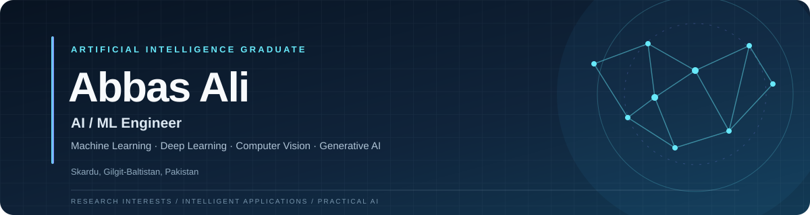

  

  
  
  

  **Artificial Intelligence Graduate · AI/ML Engineer**

  *Building practical, reliable, and impactful intelligent systems*

## 👋 About Me

I am **Abbas Ali**, an Artificial Intelligence graduate from **The Islamia University of Bahawalpur (IUB), Pakistan**, with a **CGPA of 3.59/4.00**.

My interests are in **machine learning, deep learning, computer vision, natural language processing, and generative AI**. I enjoy transforming research concepts into practical applications and working on solutions that create measurable real-world value—particularly in healthcare and digital content analysis.

- 🎓 **Education:** BS Artificial Intelligence, IUB — March 2022 to March 2026
- 📍 **Location:** Skardu, Gilgit-Baltistan, Pakistan
- 🎯 **Current objective:** Pursuing a fully funded MS in Artificial Intelligence for the 2027 intake
- 🔬 **Interests:** Intelligent applications, applied AI research, and responsible generative AI

## 🧰 Technical Expertise

| Area | Technologies |
|:--|:--|
| Languages | Python, SQL, HTML, CSS, TypeScript |
| Machine Learning | Scikit-learn |
| Deep Learning | PyTorch, TensorFlow, Keras |
| Computer Vision | OpenCV, Convolutional Neural Networks (CNNs) |
| Generative AI | Large Language Models, RAG, Hugging Face Transformers, LangChain |
| Data Science | NumPy, Pandas, Matplotlib |
| Backend & Platforms | Supabase |
| Developer Tools | Git, GitHub, Jupyter Notebook, Google Colab, VS Code |

## 🚀 Featured Projects

<table>
  <tr>
    <td width="50%" valign="top">
      <h3>AI Medical Assistant</h3>
      
An intelligent medical assistance platform that makes health information more accessible through conversational AI and document-based interactions.

      
<strong>Stack:</strong> TypeScript, Supabase, LLM Integration, RAG

      
<a href="https://github.com/abbasali-official">View Repository</a> · <a href="#">Live Application</a>

    </td>
    <td width="50%" valign="top">
      <h3>Veridex AI</h3>
      
A machine learning project for identifying potentially misleading or false news content through automated text classification.

      
<strong>Focus:</strong> Fake-news detection and text classification

      
<a href="https://github.com/abbasali-official">View Repository</a>

    </td>
  </tr>
  <tr>
    <td colspan="2" valign="top">
      <h3>Computer Vision Projects</h3>
      
Practical computer vision experiments involving image processing, face recognition, and barcode detection.

      
<strong>Stack:</strong> Python, OpenCV, Jupyter Notebook

    </td>
  </tr>
</table>

> Project links will be expanded as dedicated repositories and live demos become available.

## 🎓 Education

### The Islamia University of Bahawalpur (IUB)

**BS Artificial Intelligence** — March 2022 to March 2026  
**CGPA:** 3.59 / 4.00

Relevant coursework includes Artificial Intelligence, Machine Learning, Deep Learning, Computer Vision, Natural Language Processing, and Data Science.

## 📜 Certifications

- **Machine Learning with Python** — IBM / Coursera, 2025
- **AI on Microsoft Azure** — Microsoft, 2025
- **Google AI Essentials** — Google, 2025
- **Python for Data Science and AI** — Coursera, 2025
- **Data Analysis with Python** — IBM Cognitive Class, 2024

## 🏆 Achievements

- Selected for the **Prime Minister's Laptop Scheme 2025** on academic merit.
- Secured **third position** among university class projects for an **Automatic Hand-Wash System**.

## 🤝 Leadership & Community

### Baltikhar Students Organisation (BSO)

- **Education Secretary** — March 2023 to December 2024
- **Media Secretary** — December 2024 to December 2025
- **Publication Head** — December 2025 to December 2026

## 🤝 Let's Connect

I welcome opportunities in **AI research, academic collaboration, and meaningful technical projects**.

  <a href="https://github.com/abbasali-official"><strong>GitHub</strong></a> ·
  <a href="https://www.linkedin.com/in/abbasali-aiengineer"><strong>LinkedIn</strong></a> ·
  <a href="mailto:AbbasAli.Eng26@gmail.com"><strong>Email</strong></a>

  © 2026 Abbas Ali. All rights reserved.

